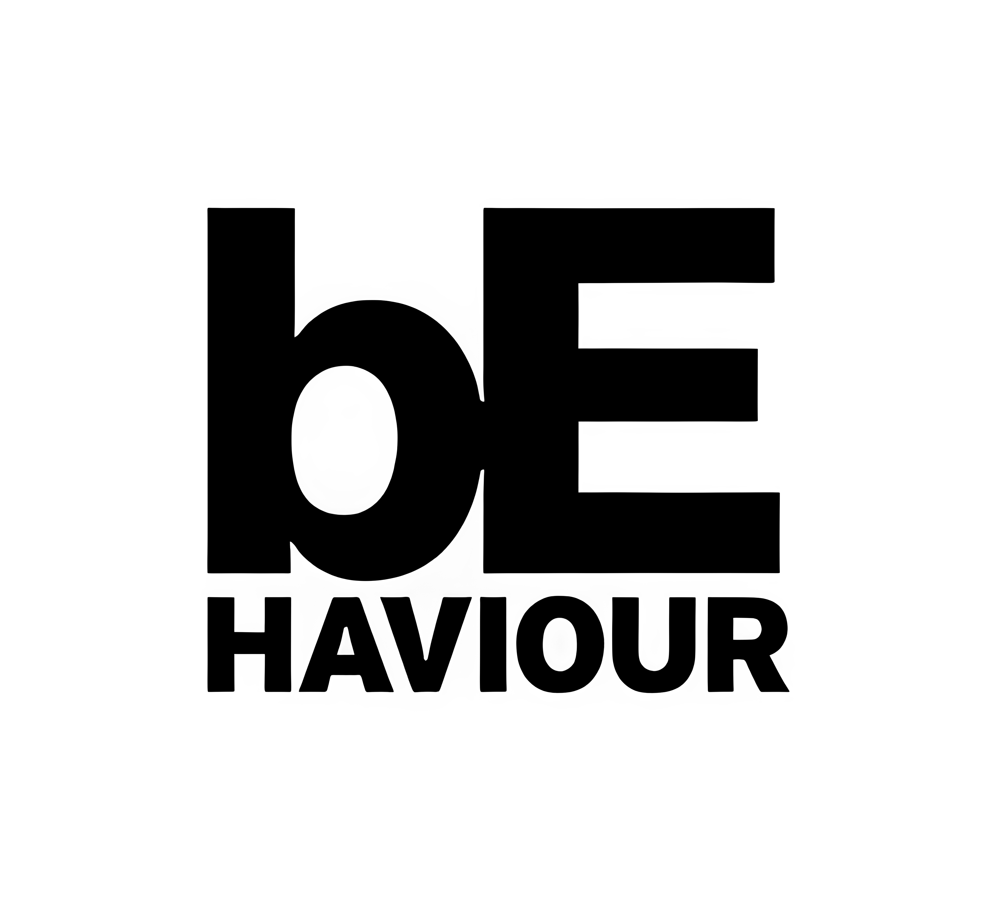
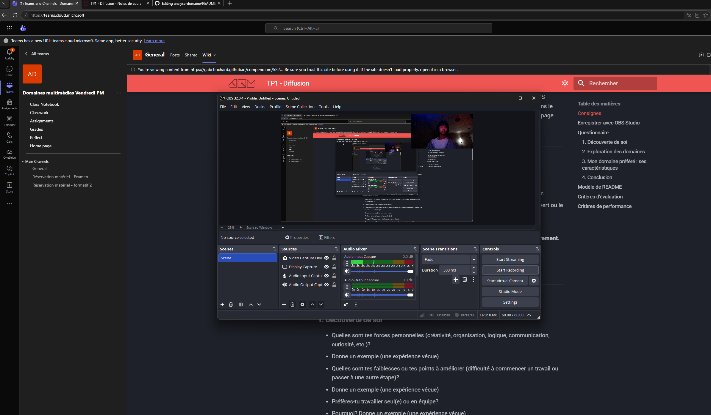

# Analyse du domaine — Sea Eric Chuop

## Découverte de soi

- Mes forces : Perseverance
    - Exemple : J'ai reussi à me rendre jusqu'a "Grandmaster" dans Overwatch, ce qui nécessite beaucoup de temps consacré
- Mes faiblesses ou points à améliorer : Rester reveillé
    - Exemple : J'ai toujours l'envie de dormir en classe
- Seul(e) ou en équipe : Seul
    - Pourquoi et exemple : Par expérience, j'ai de meilleurs notes lorsque je travaille seul
- Plutôt technique ou créatif : Technique

## Exploration des domaines

| Domaine | Intérêt | Pourquoi |
|---|---|---|
| Graphisme | Fort| L'art est quelque chose que j'apprecie |
| Vidéo et animation 2D | Fort | J'aimerais bien apprendre à faire des vidéos et de l'animation |
| 3D | Faible | Il semble très compliqué et on dirait qu'il faut beaucoup de temps pour le faire |
| Web | Faible | Avec l'IA, faire des sites web est très facile |
| Jeux vidéo | Fort | Je suis un gros fan et j'aimerais bien apprendre comment les faire |
| Développement logiciel | Faible | Pareil avec le web, l'IA y commence déja à le remplacer |
| Installations et expériences immersives | Moyen | J'aime bien voir et y participer, mais installer ne m'intéresse pas |

## Mes 2 domaines préférés

### Domaine 1 : Jeux vidéos

- Expérience : Depuis que je suis jeune, les jeux vidéos sont un loisir que j'aime beaucoup
- Logiciels et outils : Je suis agile à "modder" mes jeux avec des logiciels comme Mod Manager 2 et WinRAR, j'ai aussi un peu d'expérience avec OBS Studio
- Pourquoi il m'intéresse : Amusant, aspect social et apprentissage
- Travailler dans ce domaine : J'aimerais bien travailler dans cela, où les gens se rassemblent pour discuter des concepts de jeux, puis y réaliser

### Domaine 2 : Illustration

- Expérience : Très peu, mon seul expérience est dans mon cours d'illustration numérique
- Logiciels et outils : J'ai commencé à utiliser Photoshop
- Pourquoi il m'intéresse : Je me suis beaucoup amusé en utilisant Photoshop et en faisant des projets
- Travailler dans ce domaine : J'aimerais bien travailler dedans, où je peux faire des affiches de promotions

## Les caractéristiques de mon domaine préféré

- Types d'entreprises : Studios de développement
- Exemple d'entreprise : Techland, Virtuos, Behaviour Interactive

(source de l'image : [Gematsu](https://www.gematsu.com/companies/behaviour-interactive))

- Types de produits et de services : Jeu vidéos éléctronqique (DBD)
- Étapes de production : idéation-préproduction-production-postproduction-opération
- Type d'emploi visé : Game Balance Designer
- Étapes pour obtenir cet emploi : compréhension de mécaniques de jeux, avoir un petit projet de jeu qui est balancé,bien analyser les données

## Conclusion

- Mon profil en une phrase : Je suis un gars endormi avec un gros intérêt dans les jeux vidéos
- Ce qui m'a surpris : Rien en particulier
- Ma force principale et la faiblesse à travailler : Ma bonne compréhension de mécaniques et je dois travailler sur mon sommeil
- Mon action d'ici la fin de la session : Passer ma session

## Ma capsule

